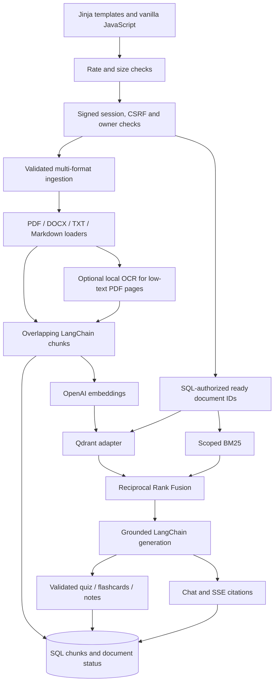

# AI Research & Study Assistant architecture

## Request boundaries

The original FastAPI/router/service/SQLAlchemy/Jinja design remains. API routers
validate inputs and delegate to services. SQLite holds users, revocable sessions,
documents, extracted chunks, conversations/messages and generated study artifacts.
Qdrant stores dense vectors with source metadata. Files stay in a non-public upload
directory. Nothing mounts private data as a static directory.

## Configuration and persistence

`config.py` loads environment settings, validates chunk overlap, retrieval mode,
explicit CORS origins and production cookie/secret requirements. The tested pins
retain LCEL on LangChain 0.3, update OpenAI so Responses exists, and remove active
FAISS/community dependencies. `database.py` supplies request/context sessions.

`migrations.py` is an additive SQLite-only versioned runner. It creates missing
tables and adds nullable owner columns plus document hash/type columns to existing
upstream tables. A ledger makes version 1 idempotent. No tables, messages, uploads
or FAISS files are dropped. Legacy ownership stays NULL and cannot match any user.
Backups remain an operator responsibility; test coverage verifies retained legacy
values across repeated migrations. There is no automatic ownership claim endpoint.

## Session security

Argon2 hashes passwords. A random session token is signed in a SameSite=Lax,
HttpOnly cookie; only its SHA256 hash is stored in `user_sessions`, together with
expiry and a CSRF token. `/api/auth/me` exposes the CSRF token to same-origin JS,
which keeps it in memory. State-changing authenticated requests require the matching
header. Logout removes the record, revoking copied signed cookies. Production
requires `Secure` cookies. Login and registration reject cross-origin fetches;
JSON validation prevents simple HTML form credential submission.

`services/security.owned` enforces ownership for every ID-based document,
conversation and study-artifact endpoint, including download, summary, reindex,
stream creation and scoring. Missing session: 401. Foreign row: 403. Missing row:
404. Source snippets are released only after authorized retrieval. Lists are scoped
at SQL level; request IDs never substitute for the authenticated owner.

## Ingestion and updates

Uploads allow ten files, each bounded by configured size. Filenames with path
separators, control characters or drive/stream syntax are rejected. UUID filenames
prevent overwrite/traversal. PDF magic and parsing, DOCX package structure and expanded
size, and UTF-8/control-byte checks validate content independently of MIME labels.
DOCX headings and tables are extracted; Markdown headings become sections. PDF
password protection, page limits, no text and corrupt content have safe errors.

Chunks preserve document ID/name, owner ID, source type, real page or section,
chunk index and stable chunk ID. Qdrant point UUIDs derive from document ID/index.
An owner/type/content hash check avoids reembedding an unchanged ready upload.
All embeddings are computed and dimension-checked before vector writes. Points
are upserted in bounded batches. SQL chunks and `ready` state commit after successful
vector writes. Failure records a safe status and attempts owner-scoped cleanup.
Queries exclude all non-ready documents and validate returned chunks against SQL,
so partial/orphan points cannot enter generation. Reindex first validates source,
skips unchanged ready documents, hides changed/failed documents while updating,
and replaces stable vector/SQL chunks. An interrupted or failed job can be retried.

Deletion removes owner-scoped Qdrant records, upload file, SQL chunks and cascading
document-scoped conversations. Qdrant failure aborts deletion with a safe service
error so the user can retry. File unlink failures return a safe retryable error; filesystem permissions
must permit cleanup. Saved learning artifacts retain their evidence until separately
deleted. No distributed SQL/Qdrant/filesystem transaction is claimed.

## Retrieval and generation

1. Optionally rewrite a follow-up using bounded conversation history.
2. Authorize requested document IDs; derive ready IDs from SQL for the current user.
3. Dense retrieval uses `QdrantVectorStore` and owner AND document filters applied
   by Qdrant. Collection size/distance and query/ingestion dimensions are checked.
4. BM25 uses only SQL chunks in the same scope. Tiny-corpus zero/negative IDF cases
   retain matching tokens; nonmatching chunks are excluded.
5. Hybrid sums `1/(60+rank)` by default across independent ranked lists, deduplicating
   stable chunk IDs. Candidates, K and fusion constant are configurable. Optional
   lexical-overlap reranking is a simple heuristic, not a neural cross-encoder.
6. Numbered source excerpts enter the original LCEL prompt and model. Documents are
   explicitly untrusted input, never role/security instructions. The model must cite
   `[Source N]`, use only sources and abstain when support is insufficient. No retrieved
   context produces a fixed fallback. This is a grounding policy, not a proof of every
   generated claim; real-model faithfulness is not measured in the offline suite.

Chat persists user/assistant messages with source metadata and bounded history.
Conversation document scope is retained when resumed and cannot be overridden by
a different ID. SSE preserves `start`, `sources`, `token`, `error`, `close`; partial
failed generations are not saved as completed assistant messages. Blocking retrieval
runs in a thread during streaming. Provider calls have timeouts, output limits and
two bounded SDK retries. After SSE headers, failures appear as safe error events.

Structured summaries still use the raw OpenAI Responses API and Pydantic validation.
Learning has separate routes/services/schemas: selected sources are retrieved,
Pydantic validates each output, and each exact evidence quote must occur in its
referenced chunk. Four distinct quiz options and zero-based answer indices are
validated. Correct answers remain server-side until score submission. Generated
artifacts belong to users. Quote presence cannot prove the model's entire interpretation.

## UI, OCR and evaluation

The dashboard adds searchable/selected document library, summaries, downloads,
retry/reindex, retrieval modes, saved study materials and a measured evaluation view.
Flashcards use accessible disclosure controls; quiz forms use radio groups. Generated
study text uses DOM `textContent`; existing chat Markdown uses DOMPurify with a safe
plain-text fallback. Existing responsive theme/styles and SSE client are retained.
The app does not require a frontend build or a JavaScript framework.

OCR is opt-in. pypdfium2 renders bounded pages locally; Tesseract recognizes only
low-text pages with per-page timeout. Page numbering remains tied to the original PDF.
Engine absence does not affect normal extraction while OCR is disabled.

The evaluation runner creates disposable SQL/Qdrant state from a safe eight-document
fixture. It compares identical questions/corpus under deterministic dense embeddings,
BM25 and hybrid. Reports contain measured Hit Rate@K, MRR, supporting context and
retrieval latency. Paid generation/faithfulness and upstream FAISS performance are
explicitly unmeasured. An authenticated endpoint exposes the safe report to the UI.

## Operational limits

One-worker SQLite/local Qdrant and corpus-wide BM25 are local-development choices.
Rate limits are process-local; a reverse proxy must bound streaming multipart bodies
and slow clients. No background queue, distributed lock, account recovery, email
verification, per-user storage quotas, malware scanning or production audit is included.
Docker, real Qdrant server, real Tesseract and browser visual QA require environmental
tools unavailable during this implementation; see the verification report.

## Learning validation recovery

Learning context is sorted in document/chunk order after authorized retrieval. If
an evidence quote occurs verbatim in the selected context but its Source number is
wrong, the service corrects only that pointer. Unsupported quotes remain invalid.
One bounded regeneration attempt requests exact quotes and valid source labels;
repeated failure persists no artifact. The study form shows inline progress/errors
and retains successfully generated cards when refreshing the saved list fails.
